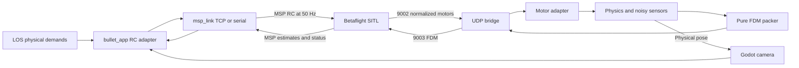

# Betaflight backend and independent MSP library

Status: implemented, locally verified, and committed on 2026-10-26. No push was requested.

## Agreed design

- Work in `/home/user/workspaces/bullet`. Preserve the independent, dirty
  `/home/user/projects/bullet` checkout and reuse its existing bridge selectively.
- Keep `control.backend: internal` as the default. Selecting `betaflight` switches
  the normal launcher and application to a managed, pinned SITL firmware.
- `los_tracking` returns physical demands: roll/pitch radians, yaw rad/s and thrust
  newtons. Move RC mapping into bullet_app. Mass, gravity and physical limits stay
  in the controller, with no firmware, PWM or socket dependencies.
- New independent `msp_link` project: MSP v1/v2 and v2-in-v1 framing, generic raw
  requests for arbitrary commands, typed flight/identification helpers, TCP and
  serial. An optional latest-RC stream repeats at 50 Hz independently of updates.
  No automatic command-age failsafe is added. Disconnect/reconnect clears armed
  replay and requires a fresh command. Stop/reset/shutdown explicitly disarm.
- Physics FDM packing is pure in `betaflight/fdm.py`. `bridge.py` owns UDP only.
  `backend.py` accepts an injected bridge, decodes normalized motor outputs and
  returns RotorCommand. No MSP or firmware process management in physics modules.
- FDM sends noisy gyro, accelerometer and barometer pressure on UDP 9003. Receive
  normalized motors on UDP 9002, retaining tested rotor order and speed mapping.
  Remove RC output on UDP 9004. Preserve existing motor validity/freshness checks.
- Compile pinned Betaflight 2026.6.2 with IMU estimation and external pressure,
  without truth-derived virtual magnetometer/GPS or direct attitude injection.
- bullet_app obtains altitude, attitude and arming status through MSP TCP 5761.
  Convert units/frames there and stamp receipt times honestly, independently for
  each measurement. Camera rendering uses physical pose, never MSP estimates.
- Launcher supervises firmware, readiness, Stop and new-episode restart. Clear
  old commands/measurements and drain UDP before an episode becomes ready.
- Keep full existing Godot takeoff/hover/search/LOS flow, wind, spawn, collision
  and MCAP recording. Include backend/firmware identity, estimates, command
  transmissions and transport timing in recorded telemetry.

## Projects and modules

- msp_link: protocol.py, transport.py, client.py, commands.py, rc.py, __init__.py.
- bullet_drone: betaflight/fdm.py, bridge.py, backend.py, __init__.py; integrate
  configuration and RcSimulation without replacing current sensor/wind models.
- bullet_app: RC conversion and MSP flight adapter, integrate runtime/mission.
- los_tracking: physical command contract, controller/hold/handoff and caller tests.
- bullet_msgs: backward-compatible backend and feedback provenance contracts.
- bullet_render: SITL supervisor, launcher and recorder configuration.
- Parent workspace: dependency registration, shared uv.lock and VS Code tasks.

## Validation results

Test framing fragmentation/checksums, raw v1/v2 requests, TCP and pseudo-terminal
serial, deadlines, 50 Hz streaming without new updates, reconnect, shutdown and
invalid input. Test pure FDM frames, fake/real UDP, motor mapping/freshness and
backend lifecycle. Test physical controller outputs and both RC profiles, keeping
internal simulation regression checks. Build pinned firmware and run actual MSP
and physics together, then the complete recorded Godot flow including restart.
Implemented checks cover fragmented/corrupt v1, v2 and v2-in-v1 frames, generic
requests, TCP reconnect behavior, 50 Hz RC replay, and a real pseudo-terminal
serial transport. Physics tests cover pure sensor FDM, real loopback UDP, motor
validation/order/freshness and lifecycle. The pinned firmware built from official
tag `2026.6.2` at `e0b7bb01b17b21351057e9ead2d1ab39dd44fa16`.

A live 240 Hz closed-loop SITL run armed through MSP, climbed on Betaflight motor
outputs and held about 3 m using MSP altitude. Separate positive roll, pitch and
yaw maneuvers confirmed MSP estimator signs against Bullet ground truth. Focused
cross-project tests passed, as did the complete los_tracking, bullet_app,
bullet_msgs and bullet_render suites. The complete bullet_drone suite passed 686
tests and retained two pre-existing PlotJuggler VS Code task failures unrelated to
this backend.

Not validated: a physical flight controller, electrical/serial latency under
load, or a complete interactive Godot target flight. Those remain integration
acceptance checks rather than implementation dependencies.

