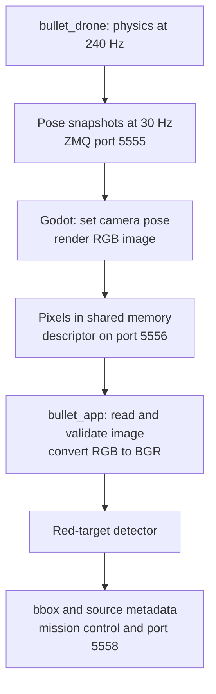

# Image-to-bbox data flow

The pipeline is **physics state → Godot camera rendering → shared-memory image
→ OpenCV detector → bbox**. Position and attitude travel together in one pose
message. Ground truth is the default; the physics YAML can select barometer render
altitude and complementary-filter IMU attitude for rendering and app feedback.
See [sensor pose configuration](../../bullet_drone/docs/design/sensors.md#sensor-pose-selection-and-attitude-estimation).



## 1. Physics produces a state snapshot

After each physics step, `bullet_drone` has the drone's world position and
body-to-world attitude as an XYZW quaternion. The external-RC runner stamps the
observation with:

- `physics_id`, `episode_id`, and `stream_id`;
- `step_index` and `simulation_time_s`;
- `measurement_us`, measured using the host's monotonic clock.

The same source stamp is reused in feedback and the pose selected for rendering.
See [the external-RC runner](../../bullet_drone/examples/external_rc/main.py).

## 2. Physics schedules a camera capture

Before publication, the selected pose keeps true X/Y and velocity, optionally
replaces Z with the barometer altitude, and optionally uses the IMU attitude
estimate computed on that physics step. Sensor noise is applied in physics only.
The selected values retain the original observation identity and timestamps.
Stopped publication reuses the cached pose without new samples or filter updates.

The current camera configuration is **640 × 480 pixels, 90° horizontal FOV,
30 FPS**. With physics running at 240 Hz, this normally schedules one capture
every eight physics steps.

The render publisher sends these two-part topic/JSON messages on ZMQ
**port 5555**:

| Topic | Content |
| --- | --- |
| `render/drone_1/config` | Stream identity, camera dimensions, horizontal FOV, and capture FPS. |
| `render/drone_1/pose` | World position, XYZW attitude, pose sequence, and source observation identity. |

The configuration is repeated periodically. The capture queue holds only the
latest pending snapshot; an older pending capture can be replaced. Physics does
not wait for Godot to finish rendering, and 30 FPS is a scheduling target rather
than a guarantee that every capture reaches the detector.

See [the render publisher](../../bullet_drone/tools/zmq_render/publisher.py) and
[the camera profile](../../bullet_render/configs/physics.json).

## 3. Godot receives and validates the pose

The native `ZmqCameraAdapter` receiver thread buffers bounded raw messages. It
does not mutate Godot scene objects.

On the main thread, `poll_request()` parses and validates the configuration and
pose, checks stream identity, sequence and freshness, and returns a capture
request containing both configuration and pose. Position and attitude are part
of this single request; there is no separate attitude request.

See [the native adapter](../../bullet_render/src/native/zmq_camera_adapter.cpp).

## 4. Godot renders from the selected pose

Godot converts Bullet's coordinate system into its own:

| Bullet | Godot |
| --- | --- |
| X forward | −Z forward |
| Y left | −X left |
| Z up | Y up |

The scene sets the drone transform from the received position and attitude,
then sets the forward camera's global transform to the same transform. Camera
resolution and horizontal FOV come from the configuration.

Godot requests one viewport update, waits for `RenderingServer.frame_post_draw`,
reads back the camera texture, and converts it to **RGB8**. The selected pose is
retained with the request while rendering completes.

See [the capture implementation](../../bullet_render/godot/main.gd) and
[coordinate conversion](../../bullet_render/godot/frames.gd).

## 5. The renderer publishes pixels and their descriptor

The native adapter checks that the returned frame belongs to the outstanding
capture request and writes the raw pixels into one of **three POSIX
shared-memory slots**. Publication is nonblocking; if all slots are busy, the
frame can be dropped.

The adapter publishes a small notification on **`camera/front/image`, port
5556**. Its single-message framing contains the topic, descriptor length, and
JSON descriptor. The descriptor identifies:

- image width, height, encoding, stride, and byte count;
- renderer session, shared-memory name, slot, and image sequence;
- capture timestamp and the original physics source stamp.

**Pixels stay in shared memory; ZMQ carries the descriptor.** A 640 × 480 RGB8
frame contains 921,600 pixel bytes, without JPEG compression.

For stamped descriptor v2:

```text
capture_ns = source.measurement_us × 1000
```

This timestamp identifies the physics observation used to render the image. It
is not the pose's arrival time, GPU completion time, or a Unix timestamp. The
shared-memory binary header remains version 1.

The physics pose sequence and renderer image sequence are separate counters;
use the preserved source identity to associate the image with its physics step.

See [the native shared-memory writer](../../bullet_msgs/include/bullet_msgs/shm.hpp).

## 6. bullet_app reads the latest complete image

In mission mode, a dedicated vision worker owns `ImageReceiver`, its ZMQ socket,
and its shared-memory reader. Its subscription retains the latest image
notification instead of building a processing backlog.

The receiver validates the descriptor, opens or reuses the slot mapping, and
takes a nonblocking shared read lock. It checks the binary header, completion
flag, session, dimensions, sequence, and capture timestamp against the
descriptor. Busy, overwritten, or duplicate frames are skipped.

The reader copies the pixels into owned memory before releasing the lock.
`ImageReceiver` reshapes the bytes into an image and converts **RGB to BGR**, the
format expected by the detector. This is shared-memory transport with owned
copies for processing, rather than an end-to-end zero-copy pipeline.

The result is `(metadata, bgr_image)`.

See [ImageReceiver](../../bullet_app/src/bullet_app/receiver.py) and
[the shared-memory reader](../../bullet_msgs/src/bullet_msgs/shm.py).

## 7. The detector extracts the bbox

The current detector uses OpenCV color segmentation:

1. Validate a nonempty H × W × 3 `uint8` BGR input.
2. Convert BGR to HSV.
3. Combine the two red HSV ranges: `(0, 100, 80)`–`(10, 255, 255)` and
   `(170, 100, 80)`–`(180, 255, 255)`.
4. Apply a 3 × 3 morphological opening to remove small noise.
5. Find external contours and choose the largest by contour area.
6. Reject contour area below 4 pixel² or bbox width/height below 3 pixels.
7. Return `(x, y, width, height)` from `cv2.boundingRect()`.

The bbox is in image pixels, with the origin at the top-left, X increasing right
and Y increasing down. No accepted contour returns `None`. The detector leaves
the input image unchanged.

See [the red-target detector](../../bullet_app/src/bullet_app/detector.py).

## 8. The bbox reaches mission control and telemetry

The vision worker stores the latest **bbox plus original image metadata** in a
protected slot. The separate 100 Hz mission thread reads that result for target
search and LOS control; GUI processing does not block the control thread.

For each newly processed image result consumed by the mission thread, the app
publishes `tracking/front/bbox` on **port 5558**. The packet contains the bbox or
null, image session and sequence, capture timestamp, and, for stamped images,
the physics source stamp. A result can be replaced by a newer vision result
before the mission thread consumes it.

Attitude is not needed for red-color segmentation itself. Mission/LOS processing
uses the preserved measurement time to align the bbox with attitude history and
checks episode identity and freshness before accepting it for control.

See [the mission and vision threads](../../bullet_app/src/bullet_app/runtime.py)
and [bbox publication](../../bullet_app/src/bullet_app/publisher.py).

## Default transport summary

| Direction | Topic | Port | Data |
| --- | --- | --- | --- |
| Physics → Godot | `render/drone_1/config` | 5555 | Camera settings and stream identity. |
| Physics → Godot | `render/drone_1/pose` | 5555 | Position, attitude, and stamped source observation. |
| Godot → app | `camera/front/image` | 5556 | Descriptor over ZMQ; raw RGB pixels in shared memory. |
| App → recorder/viewers | `tracking/front/bbox` | 5558 | Bbox or null, with image identity and source timing. |

These are the workspace defaults; endpoints and camera settings come from the
transport and physics camera profiles.

## Topic messages and fields

The table describes the stamped messages used by the external-RC mission flow.
Every listed field is required for its message version. The topic is carried by
the ZMQ envelope, rather than as a JSON property, except for the bbox packet's
`image_topic`, which names the source image topic.

| Topic | Port | Message version | Complete top-level message fields |
| --- | --- | --- | --- |
| `render/drone_1/config` | 5555 | `schema_version`: 1 | `schema_version`, `stream_id`, `camera`, `fps` |
| `render/drone_1/pose` | 5555 | `schema_version`: 3 | `schema_version`, `stream_id`, `drone_id`, `episode_id`, `sequence`, `publisher_drops`, `step_index`, `simulation_time_s`, `position_m`, `orientation_xyzw`, `linear_velocity_m_s`, `source` |
| `camera/front/image` | 5556 | Descriptor `version`: 2 | `version`, `session`, `slot`, `shm_name`, `width`, `height`, `encoding`, `step`, `bytes`, `sequence`, `capture_ns`, `source` |
| `tracking/front/bbox` | 5558 | `schema_version`: 2 | `schema_version`, `image_topic`, `session`, `sequence`, `capture_ns`, `bbox`, `source` |

The config, pose and bbox messages use two ZMQ parts: topic and JSON. The image
notification uses one part: topic plus NUL, a four-byte little-endian descriptor
length, and descriptor JSON. The image's `bytes` field is a byte count; pixel
data is in shared memory and is not a JSON field.

### Camera configuration fields

The `camera` object in `render/drone_1/config` contains:

| Field | Type | Meaning / units | Current default |
| --- | --- | --- | --- |
| `camera.width_px` | Integer | Image width, pixels. | 640 |
| `camera.height_px` | Integer | Image height, pixels. | 480 |
| `camera.fov_x_deg` | Number | Horizontal field of view, degrees. | 90 |
| `fps` | Number | Capture scheduling rate in simulation time, frames/s; top-level field. | 30 |

### Pose fields

| Field | Type | Meaning / units |
| --- | --- | --- |
| `schema_version` | Integer | Pose contract version: 3 for the stamped flow. |
| `stream_id` | String | Physics render-publisher stream identity. |
| `drone_id` | String | Drone identity; currently `drone_1`. |
| `episode_id` | String | Simulation episode identity. |
| `sequence` | Integer | Increasing pose-publication sequence within the stream. |
| `publisher_drops` | Integer | Cumulative capture-queue drops counted by the physics publisher. |
| `step_index` | Integer | Physics step represented by this pose. |
| `simulation_time_s` | Number | Time within the simulation episode, seconds. |
| `position_m` | Three-number array | World `[x, y, z]` position in Bullet coordinates, metres. |
| `orientation_xyzw` | Four-number array | Body-to-world quaternion `[x, y, z, w]` in Bullet coordinates. |
| `linear_velocity_m_s` | Three-number array | Ground-truth world `[vx, vy, vz]`, metres/second; not XY feedback for app control. |
| `source` | Object | Physics measurement identity and timing; fields listed below. |

### Image descriptor fields

| Field | Type | Meaning / units |
| --- | --- | --- |
| `version` | Integer | JSON descriptor version: 2. The binary SHM header remains version 1. |
| `session` | String | Renderer SHM publisher session: 32 hexadecimal characters. |
| `slot` | Integer | Shared-memory slot index: 0, 1, or 2. |
| `shm_name` | String | POSIX shared-memory name, such as `/bullet_msgs_<session>_s0`. |
| `width` | Integer | Image width, pixels. |
| `height` | Integer | Image height, pixels. |
| `encoding` | String | Native renderer emits `rgb8`; the reader also supports `bgr8`. |
| `step` | Integer | Row stride in bytes; native RGB8 uses `width × 3`. |
| `bytes` | Integer | Pixel payload byte count: `step × height`, excluding the 128-byte SHM header. |
| `sequence` | Integer | Renderer image-publication sequence within the SHM session. |
| `capture_ns` | Integer | Source monotonic measurement time, nanoseconds: `source.measurement_us × 1000`. |
| `source` | Object | Unchanged physics source stamp from the rendered pose. |

### Bbox message fields

| Field | Type | Meaning / units |
| --- | --- | --- |
| `schema_version` | Integer | Bbox contract version: 2 for stamped images. |
| `image_topic` | String | Source image topic, normally `camera/front/image`. |
| `session` | String | Copied from the source image descriptor. |
| `sequence` | Integer | Copied image sequence; not a new bbox counter or pose sequence. |
| `capture_ns` | Integer | Copied source image capture timestamp, monotonic nanoseconds. |
| `bbox` | Object or null | Accepted detection rectangle; null means no target accepted by the detector. |
| `source` | Object | Copied physics source stamp from the image descriptor. |
| `bbox.x` | Integer | Rectangle left edge, pixels from image left. Present when `bbox` is non-null. |
| `bbox.y` | Integer | Rectangle top edge, pixels from image top. Present when `bbox` is non-null. |
| `bbox.width` | Integer | Rectangle width, pixels. Present when `bbox` is non-null. |
| `bbox.height` | Integer | Rectangle height, pixels. Present when `bbox` is non-null. |

### Shared source object

The `source` object has the same six fields in pose v3, image descriptor v2 and
bbox v2:

| Field | Type | Meaning / units |
| --- | --- | --- |
| `source.physics_id` | String | Physics process identity. |
| `source.episode_id` | String | Simulation episode identity. |
| `source.stream_id` | String | Physics render-publisher stream identity. |
| `source.step_index` | Integer | Physics step represented by the observation. |
| `source.simulation_time_s` | Number | Observation time within the episode, seconds. |
| `source.measurement_us` | Integer | Host monotonic measurement time, microseconds. |

In a stamped pose, the nested episode, stream, step and simulation time describe
the same observation as their top-level counterparts. Rendering and detection
preserve this object. Image/bbox `session` and `sequence` identify the rendered
image, while `source` identifies the physics observation that produced it.

Legacy pose v2, image descriptor v1 and bbox v1 remain supported and omit
`source`. They are not the stamped source-association path described here.

Authoritative JSON schemas:
[config](../../bullet_msgs/src/bullet_msgs/schemas/config.json),
[pose](../../bullet_msgs/src/bullet_msgs/schemas/pose.json),
[image descriptor](../../bullet_msgs/src/bullet_msgs/schemas/image.json), and
[bbox](../../bullet_msgs/src/bullet_msgs/schemas/bbox.json).
