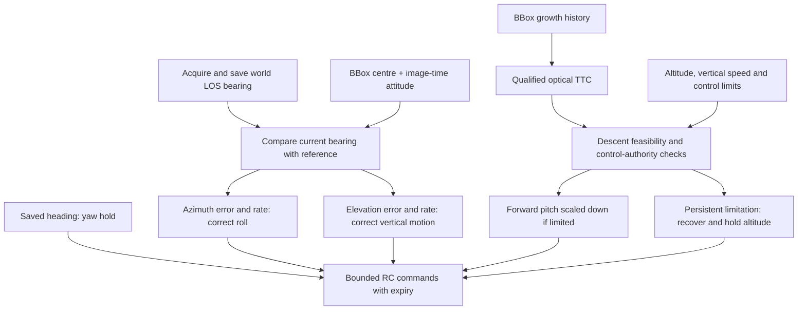
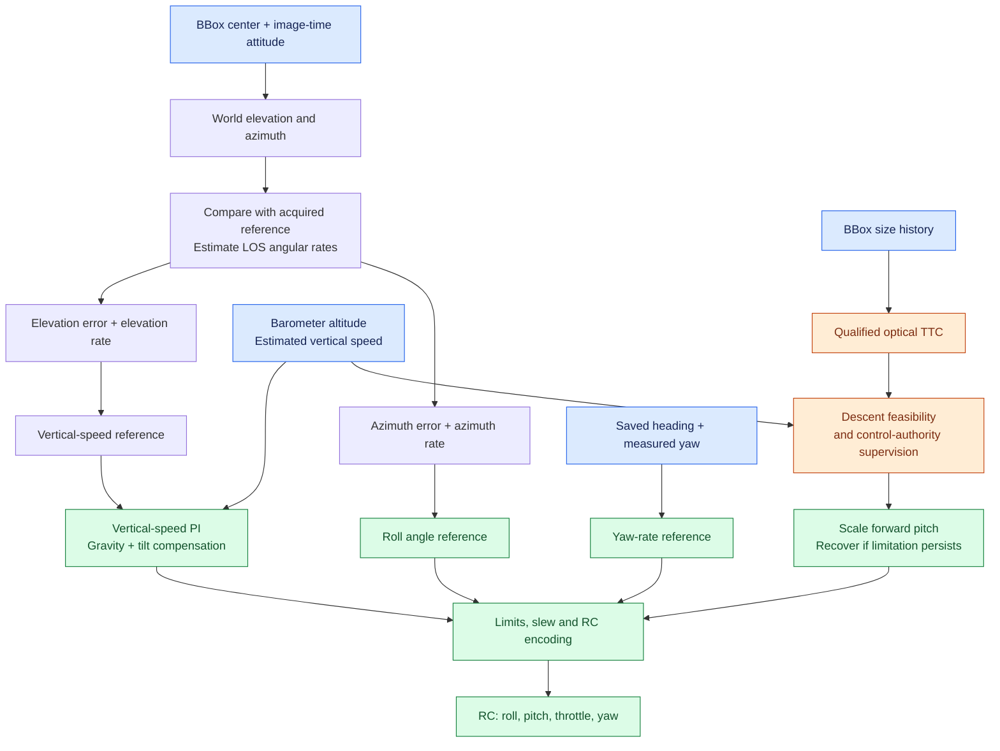
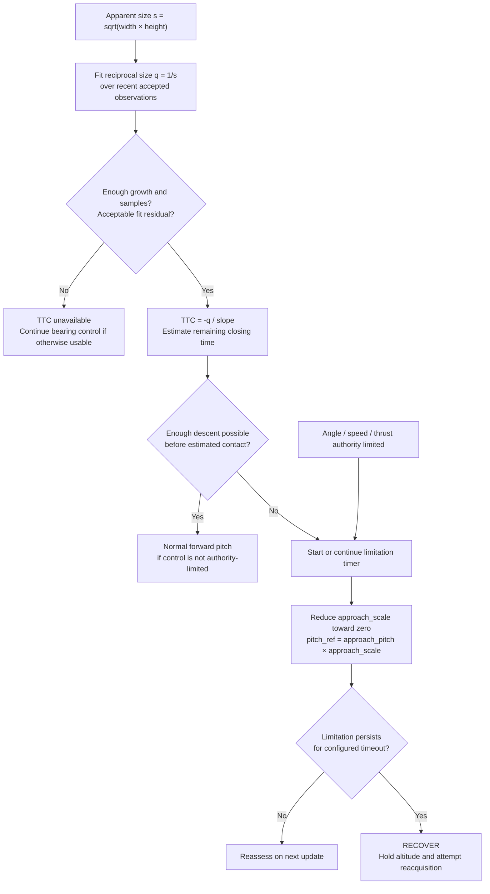
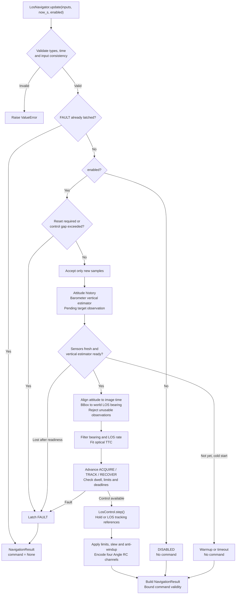
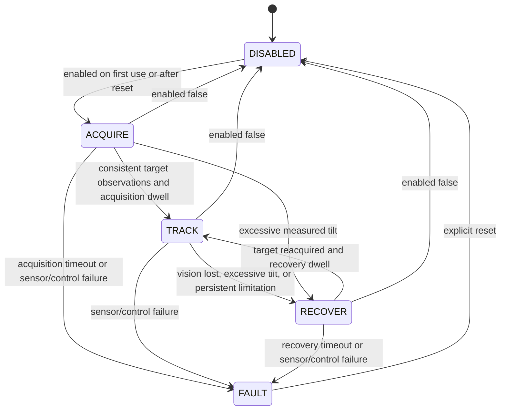
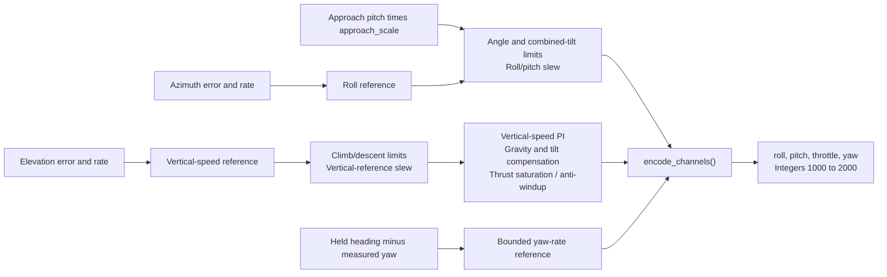

# los_tracking package flow: entry method to RC output

`los_tracking` guides an already-airborne drone toward a detected target using
its line of sight (LOS).

- **Input:** timestamped target bbox, barometer altitude and body-to-world
  attitude, together with camera/vehicle configuration, current time and
  navigation enable state.
- **Output:** four Angle-mode RC channels—roll, pitch, throttle and yaw—plus
  navigation state, diagnostics and a command-validity deadline. The command
  can be unavailable during warmup, disable or fault.
- **General idea:** align attitude with the image timestamp, convert the bbox
  into a world LOS bearing, then estimate bearing change and LOS rate. Preserve
  the acquired LOS direction during forward approach by correcting azimuth
  with roll and elevation with vertical motion, while yaw holds heading.
  Optical time-to-contact and control limits supervise the approach.

The caller owns image detection, takeoff, yaw search/centering, arming and
transport. The package consumes the resulting measurements and returns control
commands; it does not infer collision or implement landing.

### Approach idea: bearing and TTC to RC commands

At acquisition, save the target's LOS bearing as a reference. During approach,
compare the current filtered bearing with that reference and use both the
angular error and LOS angular rate to correct the flight:

- **Roll:** azimuth error and azimuth rate generate a lateral tilt reference,
  with bounded integral correction.
- **Throttle:** elevation error and elevation rate generate a vertical-speed
  reference. A vertical-speed PI controller turns that reference into thrust,
  including gravity and measured-tilt compensation.
- **Pitch:** a configured forward tilt drives the approach. Its magnitude is
  reduced when approach supervision detects insufficient descent capability
  or limited control authority.
- **Yaw:** hold the heading saved after the app centers the target.

Estimate optical **time-to-contact (TTC)** from bbox growth by fitting reciprocal
apparent size, where `size = sqrt(width * height)`. A qualified TTC estimates
the remaining closing time. Compare that time with the descent needed to reach
the configured target altitude: if descent is infeasible, or commands remain
limited, progressively reduce forward pitch and enter recovery if the problem
persists. TTC supervises the bearing-based controller; it does not directly
set throttle or establish that a collision occurred.

Finally, apply angle, speed, thrust and slew limits, then map roll/pitch angles,
thrust and yaw rate into four integer RC channels in the range **1000–2000**.

### Visual guide: what the controller is trying to do



The objective is to preserve the acquired world LOS direction during approach.
Bearing error and rate generate corrections; bbox growth supplies qualified TTC
for supervision. Actual response depends on control authority and command limits.
TTC requires a qualified history, does not establish collision, and does not
directly set throttle. Bearing uses attitude aligned to image measurement time.

### Signal paths: which measurement affects which RC channel?



Blue boxes are measurements, orange boxes are TTC supervision, and green boxes
lead to control output. **Bearing error and LOS rate generate corrections; TTC
checks whether the forward approach remains feasible.**

| What is observed? | How the controller reacts |
| --- | --- |
| Azimuth moves away from the acquired reference. | Change the roll reference using angular error, angular rate and bounded integral memory. |
| Elevation moves away from the acquired reference. | Change the vertical-speed reference; the inner PI changes thrust to follow it. |
| Bearing error is near zero but its rate is nonzero. | The derivative term still contributes a correction; the target direction is beginning to drift. |
| Bbox grows with a qualified reciprocal-size fit. | Estimate TTC and compare remaining time with available descent. Growth alone does not directly set throttle. |
| TTC is short but the descent remains feasible. | Continue the bearing-based approach; short TTC alone does not mandate slowing. |
| Descent is infeasible or control authority stays limited. | Reduce forward pitch progressively, then enter recovery if the condition persists. |

### Visualizing TTC and forward-pitch supervision



For the default 7° approach pitch, a scale of `1.0` requests 7°, `0.5` requests
3.5°, and `0.0` requests level pitch. These are requested references; slew and
tilt limits still apply before the RC command is emitted. TTC unavailability
does not disable independent control-authority supervision.

## 1. Entry method: `LosNavigator.update()`

The navigation entry method is:

```python
def update(
    self,
    inputs: NavigationInput,
    *,
    now_s: float,
    enabled: bool,
    command_horizon_s: float = 0.0,
) -> NavigationResult:
    ...
```

The caller creates one navigator per navigation session and calls this method
on its control tick. The current app calls it at 100 Hz during LOS acquisition
and approach. The package owns state between calls, but creates no execution
loop, thread, socket, detector or simulator.

`command_horizon_s` is the caller's minimum remaining image-validity budget.
The Bullet app supplies 20 ms (two 100 Hz ticks, including delivery margin).
When an otherwise usable image cannot cover that horizon, navigation holds in
ACQUIRE or enters RECOVER with `image_deadline`, before image-limited RC expires.
The default zero preserves deadline-at-expiry behavior for other callers.
Image freshness and command expiry limits are not extended.

```python
from los_tracking import (
    AttitudeSample,
    BarometerSample,
    LosNavigator,
    NavigationInput,
    NavigatorConfig,
    TargetObservation,
)

config = NavigatorConfig.from_json("examples/bullet_profile.json")
navigator = LosNavigator(config)

# One illustrative tick. Subsequent calls supply later control times and
# newly available samples; a cold navigator first needs sensor warmup.
result = navigator.update(
    NavigationInput(
        target=TargetObservation("camera", 1, 100.0, (310, 250, 20, 20)),
        barometer=BarometerSample("barometer", 1, 100.0, 20.0),
        attitude=AttitudeSample("attitude", 1, 100.0, (0.0, 0.0, 0.0, 1.0)),
    ),
    now_s=100.0,
    enabled=True,
)

if result.usable and 100.0 < result.valid_until_s:
    roll, pitch, throttle, yaw = result.command.as_tuple()
```

`enabled=True` authorizes navigation; it does not arm the drone. The caller owns
arming, Angle-mode selection, all auxiliary RC channels and command transport.

Implementation: [navigator.py](../src/los_tracking/navigator.py).

## 2. Overall update flow



This diagram summarizes the branches. In the implementation, a stream change
can also latch a fault while accepting samples, and numerical failures can
latch faults during estimation or control.

## 3. Inputs and time contract

`NavigationInput` holds three independently timestamped optional samples:

| Input | Fields | Meaning |
| --- | --- | --- |
| `target: TargetObservation` | `stream_id`, `sequence`, `timestamp_s`, `bbox` | Detection at image measurement time. Bbox is `(x, y, width, height)` in pixels, or `None` for an explicit no-target observation. |
| `barometer: BarometerSample` | `stream_id`, `sequence`, `timestamp_s`, `altitude_m` | Measured altitude in metres, in the same altitude datum as the configured target altitude. |
| `attitude: AttitudeSample` | `stream_id`, `sequence`, `timestamp_s`, `orientation_xyzw` | Unit body-to-world XYZW quaternion. |
| `now_s` | Finite number | Current control time, seconds, in the same clock domain as every measurement timestamp. |
| `enabled` | Boolean | Navigation authorization for this update. |

The bbox origin is the image's top-left; X increases right and Y increases down.
Body coordinates are forward/left/up. Altitude and vertical velocity are
positive upward. Library angles and angular rates are radians and radians/s.

The entry checks enforce:

- Control time strictly increases between calls. Reset before changing clocks.
- Measurements cannot be in the future relative to `now_s`.
- Reusing a sample identity with different contents is an error.
- Bbox coordinates must fit the calibrated image dimensions.
- New samples must advance sequence and measurement time within their stream.
  Exact repeats do not update filters; older samples are ignored and can set
  `diagnostics.input_rejection`. A stream change requires a fresh reset and
  otherwise latches a fault.

An input field set to `None` means there is no supplied sample on this tick; it
does not refresh the previous measurement. A new `TargetObservation` with
`bbox=None` explicitly reports that the detector found no target.

The caller maps transport identities and timestamps into these types. Full
physics/episode identity filtering belongs to the app adapters: those IDs are
not additional fields of `NavigationInput`.

Contracts: [types.py](../src/los_tracking/types.py).

## 4. Sensor history and vertical estimation

New attitude samples enter bounded `AttitudeHistory`. When processing an image,
the library looks up attitude at the image's `timestamp_s`, using an exact
sample or quaternion SLERP between surrounding samples. It does not
extrapolate beyond history, and rejects interpolation across an excessive gap.

New barometer measurements enter `VerticalEstimator`, an alpha-beta filter:

1. Predict altitude from the previous altitude and vertical-speed estimate.
2. Calculate measured-altitude residual.
3. Correct altitude and vertical speed using the configured filter gains.
4. Predict the filtered vertical state to the current control time when needed.

A cold filter needs at least three samples spanning its warmup interval. Before
readiness the navigator can return no command while warming up. Once sensors
have been ready, stale attitude/barometer data latches a fault rather than
silently reverting to warmup.

Without a handoff, the first ready attitude establishes the held heading and
the filtered altitude establishes the initial hold altitude.

Implementation: [geometry.py](../src/los_tracking/geometry.py) and
[estimation.py](../src/los_tracking/estimation.py).

## 5. From bbox to LOS bearing and LOS rate

For an accepted pending target, `_process_target()` checks image age, null or
clipped bbox, timestamp alignment, angular envelope, deviation from the acquired
LOS reference and jumps relative to the previous associated target bearing.

A target lacking its right attitude interpolation endpoint can remain pending
until a later update supplies that endpoint. The image-age limit bounds this
wait. Rejected targets do not become valid bearing measurements.

`world_bearing()` calculates:

```text
pixel_center_x = x + width / 2
pixel_center_y = y + height / 2

normalized_x = (pixel_center_x - camera.cx_px) / camera.fx_px
normalized_y = (pixel_center_y - camera.cy_px) / camera.fy_px

camera_ray = (1, -normalized_x, -normalized_y)
body_ray = rotate(camera.camera_to_body_xyzw, camera_ray)
world_ray = rotate(attitude_at_image_time, body_ray)

elevation = atan2(-world_ray.z, hypot(world_ray.x, world_ray.y))
azimuth = wrap(atan2(world_ray.y, world_ray.x) - held_heading)
```

Elevation is positive down; azimuth is positive left relative to the held
heading. Rotating the ray with the image-time attitude compensates for the
drone's orientation instead of treating all pixel motion as target LOS motion.

`BearingEstimator` filters accepted elevation/azimuth observations and estimates
both angular rates. Its `at(now_s)` predicts bearing to control time. Repeated
control calls do not insert duplicate measurements or create extra rate
observations.

When acquisition succeeds, the navigator saves its candidate LOS reference.
Tracking uses the wrapped difference between current filtered bearing and that
reference, together with the filtered LOS rates. The goal is to preserve the
acquired world LOS direction during approach; the library does not independently
drive pixel X to the image center.

## 6. Navigation states



| State | Behavior and output |
| --- | --- |
| `DISABLED` | No RC command. Disabled updates do not ingest sensor/target samples. Disabling an active session requires reset before enabling again. |
| `ACQUIRE` | Warm sensors if necessary, then hold altitude/heading with level roll/pitch while qualifying the target. Needs at least three accepted candidate frames spanning the acquisition dwell, and an initialized bearing-rate filter. |
| `TRACK` | Use acquired LOS reference, current bearing error and LOS rate to generate approach references. |
| `RECOVER` | Capture current altitude as a recovery hold target, reduce approach references toward hold, and attempt bounded reacquisition. Preserve the acquired LOS reference and held heading. |
| `FAULT` | Latched failure and no command. `enabled=False` does not clear it; call `reset()` for a new navigation session. |

State transitions do not necessarily change references instantly: controller
slew limits remain active during acquisition, recovery and approach.

## 7. Optical TTC and approach supervision

`TtcEstimator` uses accepted bbox sizes to estimate optical time-to-contact:

```text
apparent_size = sqrt(bbox.width * bbox.height)
fit reciprocal_size = intercept + slope * relative_time
optical_ttc = -remaining_reciprocal_size / slope
```

The fit needs enough measurements, time span and apparent growth, a negative
slope, and an acceptable relative residual. Diagnostics explain unqualified,
stale or elapsed estimates. This is an optical-depth closing model; it does not
provide measured distance or prove physical collision.

Within `TRACK`, `TrackStage` describes TTC supervision:

| Stage | Current default transition |
| --- | --- |
| `BEARING` | Default stage; also used when TTC is unavailable or at least 10 s, unless terminal has already latched. |
| `TTC` | Qualified TTC at most 8 s for a 0.3 s dwell. The 8/10 s thresholds provide hysteresis. |
| `TERMINAL` | Qualified TTC at most 0.8 s; stage latches until reset. It is not a collision/completion event. |

`descent_feasible()` compares height above configured `target_altitude_m` with
the descent available before estimated contact, using bounded vertical speed,
vertical acceleration and margins. It is a kinematic supervision check, not a
guarantee of real thrust authority.

When descent is infeasible or previous control output remains authority-limited,
the navigator progressively reduces `approach_scale`. Persistent limitation
enters recovery. TTC stages do not replace the controller with a separate
landing or collision controller.

## 8. Control law and RC encoding

`LosControl.step()` receives the filtered vertical state, latest measured
attitude, held heading, timestep and either LOS tracking errors/rates or a hold
altitude.



| Output | How it is determined |
| --- | --- |
| Roll | Acquired azimuth error and azimuth rate, with bounded integral memory and a continuity bias. |
| Pitch | Configured forward approach pitch multiplied by supervision scale; level reference during hold/recovery. |
| Throttle | Vertical-speed tracking PI plus gravity compensation, corrected for measured roll/pitch tilt and bounded by maximum thrust. |
| Yaw | Held-heading error converted into bounded body yaw rate. Target horizontal pixel error does not drive navigator yaw. |

Elevation error and elevation rate determine the tracking vertical-speed
reference, also with bounded integral memory and a continuity bias. In hold
mode, altitude error determines that reference instead. Reference slew,
roll/pitch/combined-tilt constraints and anti-windup limit commands before RC
encoding. `begin_track()` reseeds biases when entering tracking to preserve
continuity with the preceding control state.

`encode_channels()` maps roll/pitch angle, thrust and yaw rate to integer PWM
values. Its rounding and angle-limit correction keep quantized commands within
configured limits. `RcChannels.as_tuple()` returns **AETR order**:
`(roll, pitch, throttle, yaw)`.

Implementation: [control.py](../src/los_tracking/control.py).

## 9. Return value and command expiry

Every successful update call returns `NavigationResult`:

| Field | Meaning |
| --- | --- |
| `sequence` | Increasing result sequence; distinct from sensor/image sequences. |
| `generated_at_s` | Control time used to generate this result. |
| `valid_until_s` | Latest permitted use time for the command. |
| `state` | `DISABLED`, `ACQUIRE`, `TRACK`, `RECOVER` or `FAULT` enum value. |
| `stage` | `BEARING`, `TTC` or `TERMINAL` enum value. |
| `reason` | Machine-readable navigation or failure cause. |
| `command` | Four `RcChannels`, or `None` when no command is available. |
| `diagnostics` | Bearings/rates and validity flags, reference bearing, vertical state, TTC qualification, input ages/rejections, limits and control output details. |
| `usable` | Convenience property equivalent to `command is not None`; it does not check the caller's current time. |

Command validity is bounded by the earliest applicable deadline:

- `now_s + command_validity_s`;
- attitude and barometer measurement freshness limits;
- acquisition deadline while acquiring;
- last usable image's freshness deadline while tracking;
- recovery deadline while recovering.

If the expiry is already reached, the returned command is cleared. A caller
must also stop using a previously returned command when its deadline passes.
Diagnostics can retain filter estimates while validity flags are false; inspect
those flags rather than assuming every numeric estimate is currently usable.

The app adds arm/mode/auxiliary channels to build an 18-channel RC packet and
caps its transport expiry to this library deadline. The package itself sends
no messages and does not freeze or land a simulator.

## 10. Hold handoff and the app boundary

The app owns takeoff, hover, yaw search and horizontal bbox centering. Only
after centering and settling does it enable LOS navigation. These mission
phases are outside `LosNavigator.update()`.

The package provides `AltitudeHeadingHold` so that the caller can use the same
vertical estimator and control law before LOS. A continuous handoff is:

```python
# hold is an initialized AltitudeHeadingHold using the same NavigatorConfig.
# After yaw centering, select the centered measured heading.
hold.set_heading(centered_heading_rad)
handoff = hold.handoff(now_s=now_s, target_altitude_m=hold_goal_m)
navigator.reset(handoff=handoff)

# On the next, strictly later control tick:
result = navigator.update(inputs, now_s=next_now_s, enabled=True)
```

The immutable, validated `ControlHandoff` preserves filtered vertical state,
bounded attitude history and latest sensor samples, held heading/altitude,
roll/pitch and vertical-speed references, and thrust integral. It must match
the navigator configuration. It avoids a cold filter/controller restart but
does not bypass visual acquisition or sensor-freshness checks.

`AltitudeHeadingHold.command(..., yaw_rate_rad_s=...)` supports the app's search
and centering override while maintaining altitude. During LOS navigation, the
navigator uses heading hold and roll-based azimuth correction; ongoing pixel
centering is not part of its control law.

Implementation: [hold.py](../src/los_tracking/hold.py). For the preceding
render/detection path, see [image-to-bbox data flow](image-to-bbox-data-flow.md).

## 11. Timing and geometry defaults

These are current `Tuning` defaults; explicit profiles may override them.

| Setting | Default |
| --- | --- |
| Vertical warmup | At least 3 barometer samples spanning 0.1 s. |
| Attitude history / maximum interpolation gap | 0.5 s, bounded to 512 samples / 0.05 s. |
| Maximum image / attitude / barometer age | 0.1 / 0.05 / 0.2 s. |
| Maximum control gap / command validity | 0.1 / 0.05 s. |
| Acquisition frames / dwell / timeout | At least 3 / 0.1 / 5 s. |
| Recovery dwell / timeout | 0.1 / 1 s. |
| Persistent-limitation timeout | 0.75 s. |
| Azimuth / elevation envelope | ±35° / ±60°. |
| Maximum acquired-LOS deviation / association jump | 12° / 12°. |
| Approach pitch / roll limit / pitch limit | 7° / 15° / 30°. |
| Combined-tilt limit | 30°. |
| Climb / descent speed limits | 3 / 5.5 m/s. The app's preceding hold separately caps climb at 1 m/s. |
| Vertical-reference slew | 1 m/s². |
| TTC fit window / minimum span / minimum samples | 0.5 s / 0.2 s / 8. |

Configuration: [config.py](../src/los_tracking/config.py) and
[Bullet profile](../examples/bullet_profile.json).
