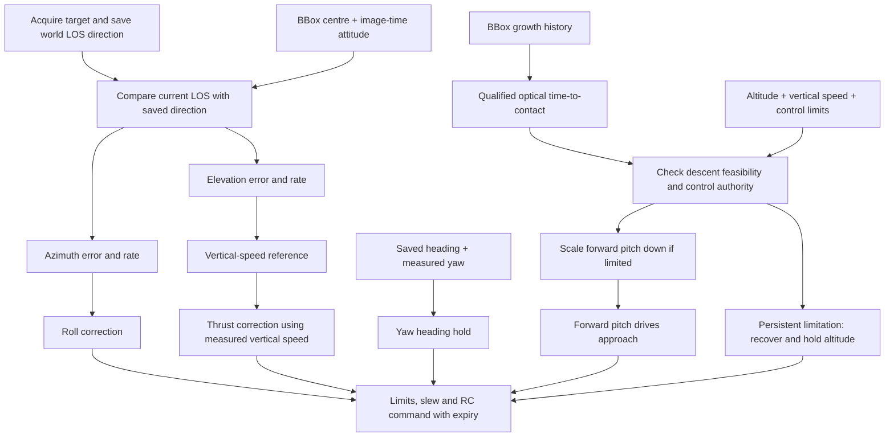

# 1. Entry method: LosNavigator.update

Source: [navigator.py](../../src/los_tracking/navigator.py), method [`LosNavigator.update()`](../../src/los_tracking/navigator.py#L226)


## Purpose and approach idea

One call advances navigation by **one control tick**. The method decides whether
measurements and session state permit control, updates estimates, chooses hold
or approach behavior, then returns an optional RC command and its deadline.

The approach preserves the world LOS direction acquired from the target. Roll
corrects azimuth error/rate; vertical motion corrects elevation error/rate;
configured forward pitch drives closing; yaw holds the saved heading. Optical
time-to-contact (TTC) and control-authority checks supervise whether that forward
approach should continue.



Read the diagram as two cooperating paths: bearing error/rate generates flight
corrections, while qualified TTC and control authority supervise forward pitch.
The objective is to preserve the acquired world bearing as the drone approaches.
TTC requires an observation history and does not establish collision.

This entry method coordinates those operations. The actual feedback equations
are implemented by `LosControl`, with geometry and estimators supplying its
inputs. The package has no execution loop, detector, socket or simulator. The
caller owns tick scheduling, takeoff, arming, flight mode, target centering and
command transport. The current app uses a 100 Hz navigation tick, but the library
calculates elapsed time rather than assuming a fixed tick rate.

## Signature and input contract

```python
def update(
    self,
    inputs: NavigationInput,
    *,
    now_s: float,
    enabled: bool,
    command_horizon_s: float = 0.0,
) -> NavigationResult:
    ...
```

| Argument | Meaning | Contract and effect |
| --- | --- | --- |
| `self` | One stateful navigator per session. | Reusing it preserves estimates, references and state between ticks. |
| `inputs` | Optional target, barometer and attitude samples. | Must be `NavigationInput`; each supplied sample has its own measurement timestamp. |
| `now_s` | Current control time in seconds. | Finite and strictly increasing between calls, in the same clock domain as measurements. |
| `enabled` | Navigation authorization. | Must be a boolean. It does not arm the drone. Disabling an active session ends that session. |
| `command_horizon_s` | Minimum remaining image-validity budget. | Finite and nonnegative; default 0. The app supplies 0.02 s. Increasing it rejects images earlier; it does not extend validity. |

Sample contracts are defined in [types.py](../../src/los_tracking/types.py):

| Sample | Payload | Meaning |
| --- | --- | --- |
| `TargetObservation` | `stream_id`, `sequence`, `timestamp_s`, `bbox` | Bbox `(x, y, width, height)` in pixels at image measurement time. `bbox=None` explicitly reports no target. |
| `BarometerSample` | `stream_id`, `sequence`, `timestamp_s`, `altitude_m` | Altitude in metres, using the same datum as configured target altitude. |
| `AttitudeSample` | `stream_id`, `sequence`, `timestamp_s`, `orientation_xyzw` | Unit body-to-world XYZW quaternion. |

An input field of `None` means no sample was supplied on this tick. It does not
refresh stored data and differs from a new target observation with `bbox=None`.
Stream IDs must be nonempty; sequences are nonnegative integers. New samples
must advance sequence and measurement time within their stream.

Coordinates and units:

- Image origin is top-left, X right and Y down.
- Body axes are forward/left/up; attitude rotates body vectors into world space.
- Altitude and vertical speed are positive upward.
- LOS elevation is positive down; azimuth is positive left relative to held heading.
- Internal angles and angular rates are radians and radians/s.

## Session setup and retained state

`LosNavigator(config)` validates the configuration type and calls `reset()`.
Configuration is immutable. Its camera, vehicle and tuning values are described
in the [parameter reference](../package-parameters.md).

| Retained state | Why the next tick needs it |
| --- | --- |
| `_last_now`, `_started_at`, `_recovery_at` | Compute timestep and acquisition/recovery deadlines. |
| `_last_samples`, `_pending_target` | Suppress duplicates, check freshness and wait for image-time attitude alignment. |
| `_attitudes`, `_vertical`, `_bearing`, `_ttc` | Preserve attitude history and measurement-driven estimates. |
| `_heading`, `_hold_altitude`, `_reference` | Preserve held heading/altitude and acquired world LOS. |
| Candidate frame times/count | Require consistent visual acquisition or reacquisition. |
| `_limited_at`, `_ttc_entry_at`, `stage` | Track persistent limitation and TTC-stage qualification. |
| `_control` | Preserve reference slew, continuity biases and integrators. |
| `_ended`, `_fault_reason`, `_sensors_were_ready` | Enforce session lifecycle and distinguish cold warmup from sensor loss. |

A cold reset starts in `DISABLED` with empty histories. A compatible
`reset(handoff=...)` restores warmed vertical state, attitude history, latest
sensors, heading/altitude and controller state. It also restores the handoff
timestamp as `_last_now`, so the next update must be later. Handoff avoids cold
sensor warmup but still requires target acquisition and fresh sensors.

Without a handoff, the first sensor-ready update establishes held heading and
altitude. `NavigatorConfig.target_altitude_m` is a different quantity: it is used
by descent feasibility, not as that initial hold setpoint.

## Execution map

```mermaid
flowchart LR
    IN["update: one control tick"] --> VALID["1. Validate arguments and time"]
    VALID --> LIFE["2. Fault / enabled / reset gates"]
    LIFE --> TIME["3. Enter acquisition, compute dt"]
    TIME --> SAMPLES["4. Ingest new measurements"]
    SAMPLES --> READY["5. Require ready, fresh sensors"]
    READY --> VISION["6. Hold initialization and vision processing"]
    VISION --> STATE["7. Tilt, acquisition and recovery transitions"]
    STATE --> SUP["8. TTC and authority supervision in TRACK"]
    SUP --> CTRL["9. Control and bounded command expiry"]
    CTRL --> OUT["NavigationResult"]
```



The map shows the normal path. The [update-cycle blocks](update-cycle.md) identify exceptions and early
returns. A missing command can be a normal warmup/disable outcome or a fault;
inspect `state` and `reason` to distinguish them.

[Back to walkthrough](../approach-walkthrough.md)
